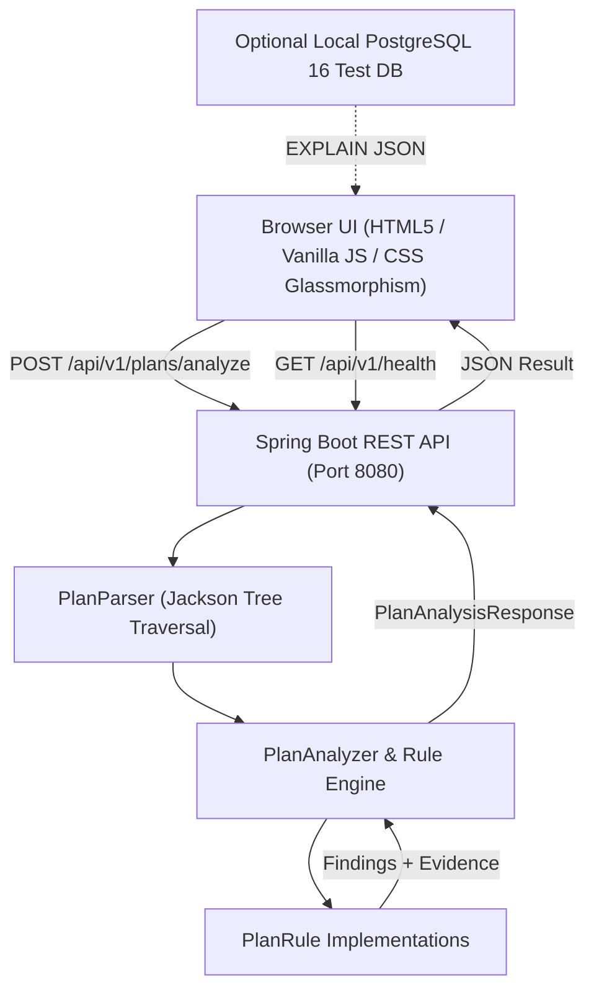

# QuerySleuth Architecture Documentation

## Overview
**QuerySleuth** is a free, locally running developer tool designed to investigate PostgreSQL performance problems, identify suspicious SQL operations, and explain persistent database errors.

## System Architecture

## Core Modules & Design Decisions

### 1. Separation of Parsing and Rule Evaluation
Parsing is completely decoupled from rule evaluation. `PlanParser` reads raw PostgreSQL EXPLAIN JSON (handling arrays, wrappers, and bare root plans), recursively normalizes property keys, maps standard fields into typed properties, retains unmapped properties in `rawProperties`, and computes derived metrics such as:
- Cumulative vs Exclusive Node Execution Time
- Total shared buffer hits and reads
- Temporary disk blocks read/written

### 2. Evidence-Based Confidence Model
The Rule Engine avoids guesswork. Every `Finding` produced contains:
- `id`: Unique identifier (e.g., `FINDING-EST-node-0`)
- `category`: Category (`PERFORMANCE`, `ESTIMATION_ACCURACY`, `RESOURCE_UTILIZATION`)
- `severity`: Severity level (`HIGH`, `MEDIUM`, `LOW`, `INFORMATIONAL`)
- `confidence`: Confidence rating (`HIGH`, `MEDIUM`, `LOW`)
- `evidence`: Empirical numbers (actual vs estimated rows, discarded rows ratio, loop counts)
- `suggestedNextStep`: Actionable recommendations (e.g., ANALYZE, CREATE STATISTICS, indexing review)
- `targetNodeId`: Link directly to the node in the plan tree

### 3. Reporting Limitations
Per the core design specification, if an input plan lacks `ANALYZE` or `BUFFERS`, the engine explicitly surfaces limitations warnings rather than silently presenting incomplete analysis as conclusive.

### 4. Zero External Subscriptions or Cloud Dependencies
QuerySleuth runs 100% locally on your machine with minimal memory footprint (< 150 MB RAM for Spring Boot).
